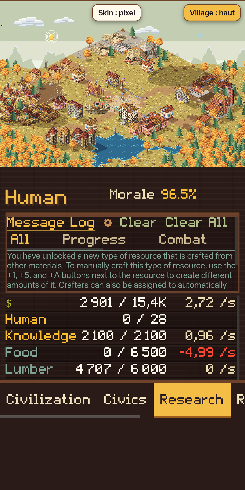
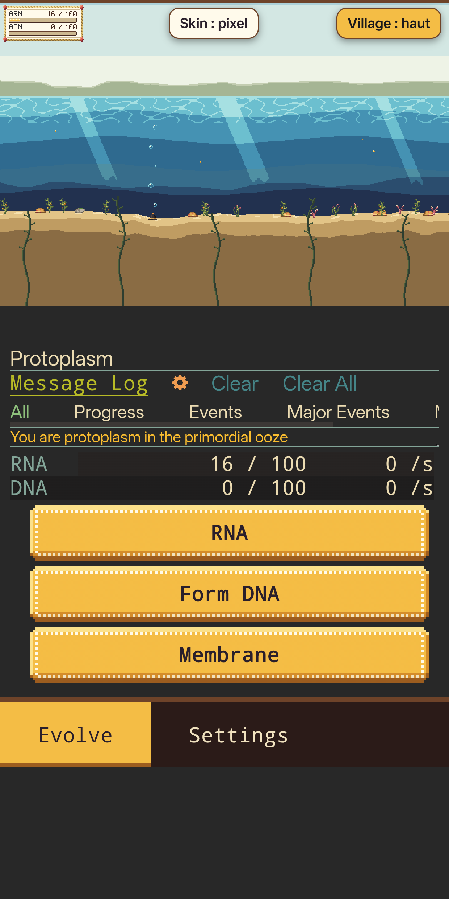
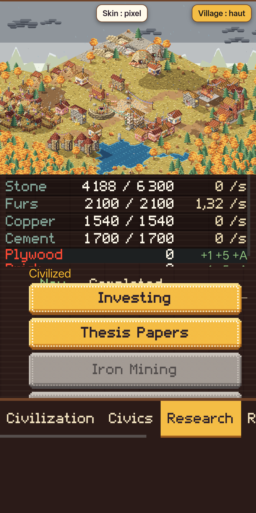

# Evolve-PixelVillage

**A fork of [Evolve](https://github.com/pmotschmann/Evolve) (the text-based incremental game) that adds a living pixel-art view of your civilisation, a pixel skin for the interface, and a phone-friendly layout. Fully offline.**

<p align="center">
  
  
  
</p>

> ### Status: humans only, Era 0 and Era 1
> What is designed and drawn today is **only the human species**, **Era 0** (the evolution phase, human path) and **Era 1** (the primitive era and the early civilized era, up to the discovery era).
> **The roadmap is to cover every era and every species of the game** (see [ROADMAP.md](ROADMAP.md)). Anything beyond that still shows the original text interface, with no pixel view.
> This is an early, unofficial project, tested by hand on one phone. Expect rough edges.

## What it adds to Evolve

| | |
|---|---|
| **Era 0 view** | A pixel-art primordial pool that grows with your RNA/DNA, cell parts and evolution stage (soup, cells, phagocytosis, colony, worm, mammal, ape), then a shoreline, then the first human beside a campfire. |
| **Era 1 village** | An isometric village drawn from the game state: 27 building types in 3 material tiers, 18 jobs, citizens that walk and work, resource piles, smoke, scaffolding, seasons, weather, 12 biomes, a far forest around the map. |
| **Pixel skin** | Pixel buttons (yellow = you can afford it, grey hatched = you cannot), wooden frames, a generated pixel font (`KitPixel`), warm walnut page background, pixel resource rows and message log. |
| **Phone layout** | One column, the village pinned at the top, a bottom tab bar, big touch targets, info bubbles on **long press** (a normal tap acts). |
| **Offline, no tracking** | No analytics, no web fonts, no CDN: Google Fonts, Google Tag Manager, unpkg and the GitHub version check were removed; libraries are vendored in `lib/`. |
| **Humans** | At sentience the humanoid genus always gives the `human` species. |
| **Sprite atelier** | `atelier.html` shows every piece, building, citizen, effect and a village simulator with a self-check (267 hand-drawn pieces, zero pixels outside the palette). |

## Quick start

No `npm install` is needed to play (the game bundle is committed, as upstream does).

```sh
node serve.js            # then open http://127.0.0.1:8765/
```

It must be served over http (not `file://`): the game loads its texts with AJAX.
On Android with Termux: `./jouer.sh` starts the server and opens the browser.
Append `?skin=off` to the address, or use the on-screen "Skin" button, to get the original interface back. The "Village" button cycles the view: hidden, top (bottom on desktop), fullscreen.

Your save game is stored in the browser's `localStorage` for the address you use (`127.0.0.1:8765`); keep the same port.

## How it works

The sprite kit (`kit/`) is plain JavaScript and Canvas 2D, with no framework. **Pieces** are small text grids where each character is a palette slot and tone (`.` transparent, `1`-`5` main tones, `a`-`d` accent, `w`-`z` wood…); a **procedural generator** composes them into isometric buildings (walls, roofs, textures), citizens (layers: legs, torso, tool, arms, head, hair, hat), terrain, seasons, weather and particles. Everything is deterministic (seeded) and every pixel comes from one palette made of recolourable ramps.

The view reads `window.evolve.global`, a read-only copy of the game state that Evolve publishes when its `expose` setting is on. This fork forces `expose` on. Nothing in the game logic is changed, except the small patches listed below.

`SpriteKit.render(state, dt)` draws Era 0 while `race.species === 'protoplasm'` and the village afterwards; `anki-village.js` is the host page script (panel, scaling, error display) and `anki-skin.js` builds the skin images from the kit.

## Changes to upstream files (MPL-2.0 notice)

| File | Change |
|---|---|
| `index.html` | Local libraries instead of unpkg, no Google Fonts / Tag Manager, loads `pixel.css`, `anki-village.js`, `anki-skin.js`. |
| `src/vars.js` | `settings.expose` always on. |
| `src/main.js` | Version check against github.io removed; `window.ankiCredit(resource, amount)` hook added (credits a resource through the game's own `modRes`). |
| `src/actions.js` | The humanoid genus always gives `human`. |
| `src/functions.js` | Touch screens: info bubbles open on a long press and close when the finger lifts. |
| `evolve/main.js` | Rebuilt from `src/` with esbuild. |

New files: `kit/`, `evolve/pixel.css`, `evolve/kitpixel.ttf`, `anki-village.js`, `anki-skin.js`, `atelier.html`, `serve.js`, `jouer.sh`, `tools/`, `kit-patches/`, `project-docs/`. See [NOTICE](NOTICE).

## Roadmap in one paragraph

Finish and playtest Era 1; draw the remaining eras (discovery, industrialized, globalized, early space, deep space, solar, Tau Ceti, interstellar, intergalactic, dimensional, existential and the prestige layers); then cover **every species** (the game has about 60 playable species in about 20 genera, with different materials, housing, food and even worlds, e.g. aquatic or fire-based) and all evolution branches. Later: a touch-first interface, translations, an optional flashcard integration. Details, ordering and the per-era workflow are in [ROADMAP.md](ROADMAP.md).

## Repository layout

```
index.html, evolve/, src/, lib/ …   the game (upstream, with the patches above)
kit/                                 the sprite kit (pieces_b1…b9, generator, village, citizens, world, ui, era1, evolution)
atelier.html                         inspect every piece and simulate a village
evolve/pixel.css, kitpixel.ttf       the pixel skin and the generated pixel font
anki-village.js, anki-skin.js        host script (view panel) and skin loader
kit-patches/                         local patches on top of the kit (re-apply after re-importing the kit)
tools/make-font.js                   builds kitpixel.ttf from the kit's bitmap font
tools/phone-test/                    developer tools to test on a rooted phone
project-docs/                        audits, method, prompts, screenshots (see project-docs/README.md)
```

## Development

```sh
# rebuild the game bundle from src/ (esbuild is a build-time tool only; install it in any folder outside the repo,
# the repo's own devDependencies are not needed and one of them fails to install on Android/Termux)
mkdir -p ~/tools/esbuild && (cd ~/tools/esbuild && npm init -y && npm install esbuild)
NODE_PATH=~/tools/esbuild/node_modules node buildEvolve.js

node tools/make-font.js         # regenerate evolve/kitpixel.ttf
sh kit-patches/apply.sh         # after re-importing the kit from Claude Design
```

Checks used so far: the kit's built-in self-check (`SpriteKit._.selfCheck()`), a headless smoke test with a fake canvas that renders every evolution stage and the hand-over to the village, and manual runs on a phone. There is no automated end-to-end test yet.

## Known limitations

- Humans, Era 0 and Era 1 only. Other species and eras fall back to the original interface.
- Developed and checked on one Android phone (Brave). Desktop layout, other browsers, other themes, settings, market and modal windows are untested.
- Several rules were read from the game source and never confirmed in play (for example when a building counts as "running"). See `project-docs/audit/`.
- The audit documents were produced by AI agents reading the source code; they are working notes, not verified specifications.

## Credits and licence

- **Evolve** is by Peter Motschmann ([pmotschmann/Evolve](https://github.com/pmotschmann/Evolve), play it at [pmotschmann.github.io/Evolve](https://pmotschmann.github.io/Evolve/)), licensed MPL-2.0. This project is an unofficial fork and is not affiliated with or endorsed by the original author. Please support the original game.
- The pixel-art sprite kit was designed with **Claude Design** and the integration code was written with **Claude Code** (Anthropic). The whole project is AI-assisted and directed by a human.
- Licence: **MPL-2.0**, like upstream (see [LICENSE](LICENSE)). Modified upstream files stay under MPL-2.0; new files are also offered under MPL-2.0.
